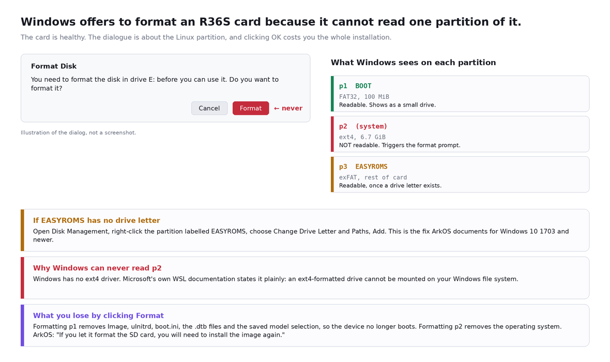
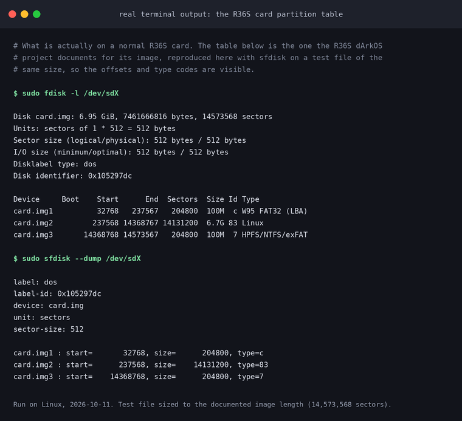
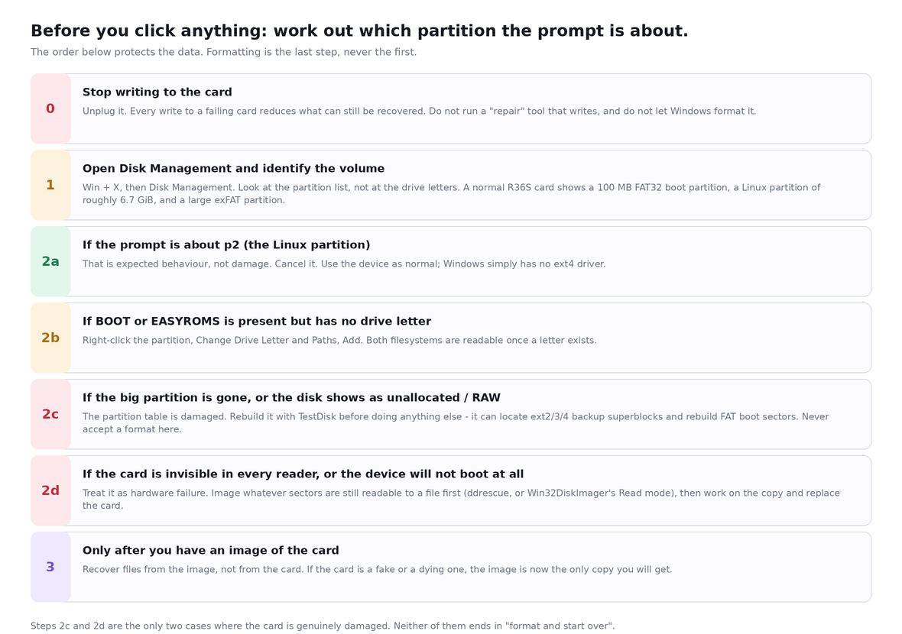
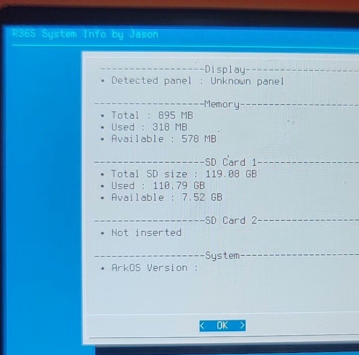
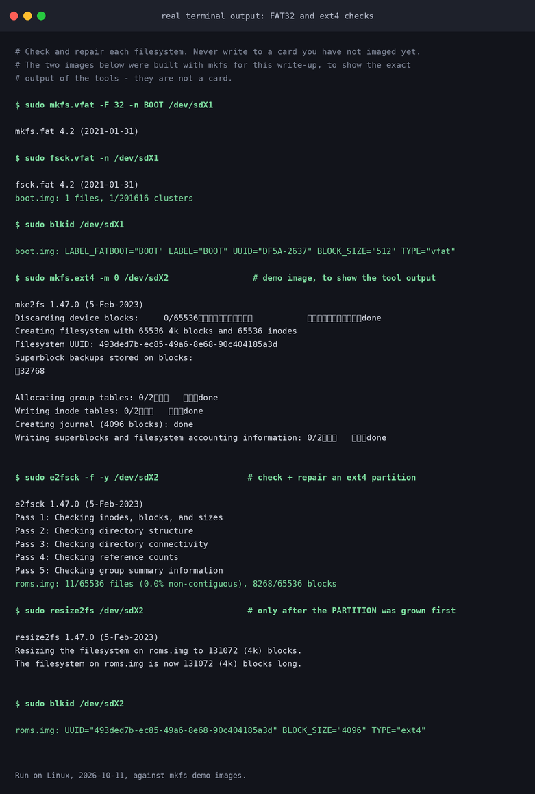
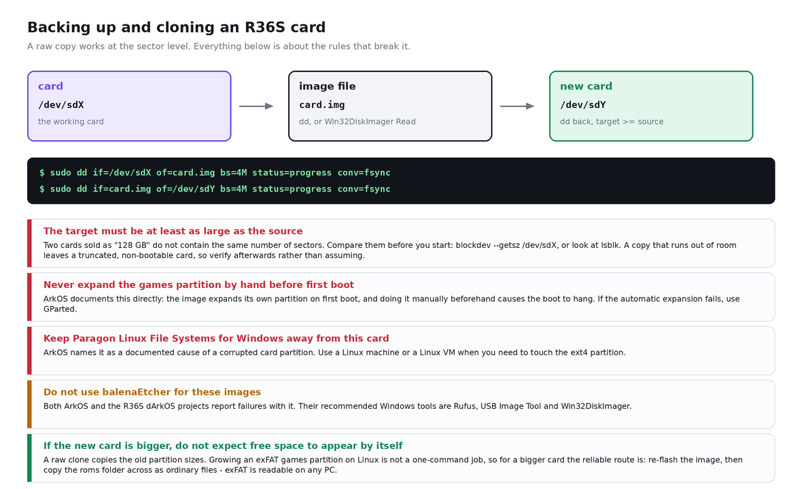

# R36S SD card: Windows says "you need to format the disk". Don't — here is how to recover it

**English** · **[中文](README.zh-CN.md)**

> **Short answer.** On a healthy R36S card that prompt is usually about the **Linux (ext4) partition**,
> which Windows has no driver for. The card is not broken and the games are not lost. Click **Cancel**.
> If you click Format, you destroy the boot partition or the operating system, and ArkOS's own
> instructions say the fix is then to re-image the whole card.
> Only two situations are real damage — the partition table is gone, or the card is dying/fake — and
> neither of them is fixed by formatting either. Both are fixed by **imaging the card to a file first**
> and then working on the copy.

This page is the whole procedure: how to tell the two cases apart, what to do in each, how to image and
clone a card so this never costs you a library again, and which popular tools you should not use on
these images.

---

## 1. What people actually report

Verbatim messages from Chinese handheld QQ groups. Group names only — the archive they came from does
not reliably identify individual senders.

> `[r36s（开源掌机）交流1群]` 我TF卡突然读不出来东西了，一直显示要格式化，插进掌机里也打不开，谁能救一救

*"My TF card suddenly won't read anything, it keeps saying it needs to be formatted, and it won't open
in the handheld either. Somebody save me."*

> `[r36s（开源掌机）交流1群]` 大约17点多想导入个游戏，首先显示要格式化，插进掌机里也打不开，现在很急。

*"Around 5pm I wanted to import a game. It first said it needed formatting, and it won't open in the
handheld either. I'm in a hurry."*

> `[R36S掌机爱好者]` 我搞了那么久的系统主题，游戏测试归类，弄了320个游戏，结果今早连手机后，掌机就不读卡了，机都开不起
> 具体情况是，手机连tf卡整理文件，结果突然就掉连接了，再重新连接就始终显示不出来了，当时想估计是坏菜了
> 只读得起boot分区 ／ roms分区的盘都读不出来
> 对了，踩坑提醒，尽量还是不要用otg转接读卡器来读tf卡
> 也就是尽量还是不要用手机读tf卡，用电脑更稳妥

*"I spent ages on my system theme, testing and sorting games, got 320 games together — then this morning
after connecting it to my phone, the handheld stopped reading the card and wouldn't even boot. What
happened: I was sorting files on the TF card through the phone, the connection suddenly dropped, and on
reconnecting it never showed up again. I figured it was dead. Only the boot partition reads — the roms
partition won't show up at all. By the way, a pitfall warning: try not to use an OTG card reader to read
a TF card. Try not to read TF cards with a phone — a computer is safer."*

> `[r36s（开源掌机）交流1群]` 系统在卡上你格式化了不就烷基八氮了吗

*"The system is on the card — if you format it, isn't that the end of everything?"*  ← correct, and worth
tattooing on the card reader.

> `[r36s（开源掌机）交流1群]` 请问大家有没有克隆内存卡的方法呢，我的月光宝盒掌机32G内存卡用傲梅轻松备份克隆，得用64G内存卡才行，我刚买的R36S在备份内存卡，不知道128G内存卡能不能克隆

*"Does anyone have a way to clone a memory card? For my 32 GB Moonlight Box card I used AOMEI Backupper
to clone and it needed a 64 GB card. I'm backing up the card of the R36S I just bought — I don't know
whether a 128 GB card can be cloned."*

> `[r36s（开源掌机）交流1群]` 请问大家，不同商家的R36S掌机都是V30主板的掌机，游戏内存卡可以通用吗

*"Question: these R36S handhelds from different sellers all have a V30 board — are the game memory cards
interchangeable?"*

> `[r36s（开源掌机）交流1群]` 这个掌机内存卡实际容量只有90G，国产卡
> `[r36s（开源掌机）交流1群]` 花点钱买个好点的内存卡，一卡玩三代

*"This handheld's card is only actually 90 GB — a domestic card." / "Spend a bit more on a decent card;
one card lasts three generations."*

Two of these deserve to be answered directly, and they are the two answers this page is built around:
**the volume Windows cannot read is the Linux one, not the games**, and **the game card is portable but
the OS card is not**, because the OS card carries the kernel and the device tree for one specific board.

---

## 2. Why Windows says it

### 2.1 The card has three partitions; Windows can read two of them



A normal R36S card looks like this. The table is the one the R36S dArkOS project documents for its image
— an MBR table with three partitions — reproduced with `fdisk`/`sfdisk` on a same-sized test file so the
offsets and type codes are visible:



| Partition | Start sector | Size in the image | Type code | What it is |
|---|---|---|---|---|
| p1 | 32768 | 100 MiB | `0c` W95 FAT32 (LBA) | `BOOT`: `KERNEL`, the `.dtb` files, `boot.ini` |
| p2 | 237568 | 6.7 GiB | `83` Linux (ext4) | the operating system |
| p3 | 14368768 | 100 MiB placeholder | `07` HPFS/NTFS/exFAT | named `EASYROMS`, grown to fill the card on first boot |

So:

- **p1 `BOOT`** is FAT32. Windows reads it, and it is the small drive that appears first.
- **p2 (ext4)** Windows cannot read at all. Microsoft's own WSL documentation says it without hedging:
  *"If you have an Ext4-formatted drive, you cannot mount it on your Windows file system."* Windows has no
  ext4 driver, so it sees a volume with an unknown filesystem — and its standard reaction to an unknown
  filesystem on removable media is to offer to format it.
- **p3 `EASYROMS`** is exFAT and Windows *can* read it. If it does not appear, that is usually a missing
  drive letter, and the documented fix is a drive letter, not a format.

### 2.2 Why the "no drive letter" case is so common

The ArkOS documentation addresses Windows 10 1703-and-newer users specifically: if you do not see a drive
letter named `EASYROMS`, open Disk Management, right-click the partition carrying that label and assign a
drive letter. You normally only need to do this once per PC. The dArkOS documentation has the same page
for the R36S, and it names both `BOOT` and `EASYROMS` as the two filesystems that can go missing from
Explorer for exactly this reason.

Related, and worth knowing because it is such a widely-suggested workaround: **you cannot use
`wsl --mount` for this.** Microsoft's documentation is explicit that *"the `wsl --mount` command does not
currently support USB/flash drives/SD card readers"*, and that it requires administrator rights and
Windows 11 (or the Store version of WSL). Any guide telling you to mount your R36S card in WSL does not
work — and on an R36S card you do not need it, because the partition that holds your games is exFAT,
which Windows reads natively.

### 2.3 What clicking Format actually costs

> ArkOS documentation, word for word: *"Once the image has been completed, Windows may ask you if you
> want to format the SD card. **MAKE SURE TO CLICK CANCEL ON THIS QUESTION!** If you let it format the SD
> card, you will need to install the image again."*

That is about the flashing step, but it applies every time the dialogue appears:

- Format **p1 (`BOOT`)** and you lose `KERNEL`, the `.dtb` files and `boot.ini`. The device will not boot.
  The card still holds your games, but you now need a re-flash to use them.
- Format **p2 (ext4)** and you lose the operating system. This is the partition Windows is usually
  complaining about, and it is the one with nothing on it that Windows can show you — which is exactly why
  people click OK.
- Format **p3 (`EASYROMS`)** and you lose the games and the `roms` folder structure. Recoverable by
  copying files back, but you must not delete the folders the emulators depend on: ArkOS warns that the
  PSP and NDS folders contain files those emulators need.

Formatting is not a "reset the card to a known good state" button on a device whose operating system
lives on the same card.

### 2.4 The two cases where the card really is damaged



1. **The partition table is gone.** Disk Management shows the whole card as unallocated, or the large
   partition shows as `RAW`, and the device does not boot. Windows will happily offer to "fix" this by
   creating one big empty partition — which overwrites the table that still points at your data.
   **TestDisk** exists for exactly this: it reconstructs a lost partition table, recovers FAT boot sectors
   from their backups, and can locate ext2/3/4 backup superblocks.
2. **The card is dying or counterfeit.** It disappears from every reader, or the device will not boot
   even though the same card worked yesterday. The group member who lost 320 games after an OTG session
   on a phone is describing this class of failure. Copy whatever sectors are still readable to an image
   file, then replace the card. A card that has started doing this does not come back.

The third possibility worth ruling out is simply a **fake-capacity card** — one that reports 128 GB and
really has 8 GB, so everything past the real capacity silently overwrites itself. `f3`
("Fight Flash Fraud") on Linux/macOS and `h2testw` on Windows test for this. The quoted group member
noticing that their "128 GB" card is "actually only 90 GB" is the benign version of the same discovery.

### 2.5 Ground truth from a real unit



Our own unit's System Info screen. Two things worth reading off it: **SD Card 1 reports 119.88 GB**,
which is the figure you expect from a card in the 128 GB class — the usual decimal-vs-binary gap, not
evidence of a fake card — and **SD Card 2 is listed separately**, which is the second slot. That second
slot is what makes the "my games card is interchangeable" question below interesting.

---

## 3. How to recover, in order

**Step 0 — stop writing to the card.** Unplug it. Do not run a "repair" tool that writes. Do not let
anything format it. Every write to a failing card reduces what can still be recovered.

**Step 1 — identify the volume.** On Windows, `Win + X` → Disk Management. Read the partition list, not
the drive letters: a healthy R36S card shows ~100 MB FAT32, ~6.7 GiB Linux, and a large exFAT partition.
On Linux, with the card inserted:

```bash
lsblk -o NAME,SIZE,FSTYPE,LABEL,MOUNTPOINT
sudo fdisk -l /dev/sdX
```

`lsblk` tells you the filesystems and labels; `fdisk -l` prints the partition table with offsets and
type codes. If `fdisk` reports a table that matches the one above, the card is structurally fine and the
prompt was about ext4. If it reports no partitions, go to step 3.

**Step 2 — if the prompt was about p2, cancel it and carry on.** Nothing is wrong. This is the normal
state of a healthy R36S card on Windows. Read the games partition, which is exFAT. If `EASYROMS` has no
drive letter, assign one; if you need to touch ext4, do it from Linux — and note that ArkOS specifically
names Paragon Linux File Systems for Windows as a cause of corrupted cards, so that particular Windows
ext4 driver is the one to avoid.

**Step 3 — image the card before you attempt any repair.** This is the step people skip, and it is the
only one that makes the rest safe:

```bash
sudo dd if=/dev/sdX of=~/r36s-card.img bs=4M status=progress conv=fsync
```

Use `ddrescue` instead when the card is failing, so a bad sector does not end the copy:

```bash
sudo apt install gddrescue
sudo ddrescue -d -r3 /dev/sdX ~/r36s-card.img ~/r36s-card.map
```

`-d` (`--idirect`) bypasses the kernel cache; `-r3` (`--retry-passes=3`) retries bad areas three times;
the third argument is the mapfile, which lets you resume and tells you exactly which regions never came
back. On Windows, **Win32DiskImager** does the same job — its own documentation describes it as being
designed to *"write a raw disk image to a removable device **or backup a removable device to a raw image
file**"*, and it recommends doing a Read before you ever write to a device.

Then work on `~/r36s-card.img`, or on a copy of it. Nothing you do from here can make the card worse.

**Step 4 — if the partition table is missing, rebuild it.** Run TestDisk against the card (or the image):
it can rewrite a lost partition table, recover a FAT32 boot sector from its backup, and find ext2/3/4
backup superblocks. Accept the proposed table only after checking the listed partition sizes against the
table in section 2.1 — 100 MB, roughly 6.7 GiB, then the rest.

**Step 5 — get your files out.**
On Windows, **DiskGenius** documents reading and recovering EXT4/3/2 partitions, and it can also browse
and copy files off a partition Windows itself refuses to mount. That is the tool to use when you need to
pull something out of the ext4 system partition.
For deleted or badly damaged filesystems, **PhotoRec** (same project as TestDisk) carves files out by
content and does not care that the directory entries are gone — it cares about the file signatures.

**Step 6 — if you only need the card to work again, re-flash rather than repair.** A dd image of a known
good card, or the original `.img` from the project, restored with `dd`, Rufus or USB Image Tool, is
faster and far more reliable than repairing a damaged ext4 partition by hand. Then copy your roms back.

**Step 7 — check the filesystems, and only then trust the card.**



```bash
sudo fsck.vfat -n /dev/sdX1     # -n = check only, change nothing
sudo e2fsck -f -y /dev/sdX2     # -f = force a full check, -y = answer yes
```

`fsck.vfat -n` is a read-only check; if it reports problems you can re-run it without `-n` to let it fix
them. `e2fsck` on a mounted filesystem is a bad idea — start with `-n` if you want a look before you let
it write. Run these against the **image** first if the card is suspect.

### Tool summary

| Need | Windows | Linux / macOS |
|---|---|---|
| Read the partition table | Disk Management, DiskGenius | `lsblk`, `fdisk -l`, `sfdisk --dump` |
| Image the card to a file | Win32DiskImager (Read), DiskGenius | `dd`, `ddrescue` |
| Write an image back | Rufus, USB Image Tool, Win32DiskImager | `dd` |
| Rebuild a lost partition table | TestDisk, DiskGenius | TestDisk |
| Read / recover ext4 content | DiskGenius | mount it, `e2fsck`, PhotoRec |
| Carve files out of a broken filesystem | PhotoRec | PhotoRec |
| Check FAT32 / ext4 integrity | DiskGenius (check & repair) | `fsck.vfat`, `e2fsck` |
| Test for a fake card | `h2testw` | `f3probe`, `f3write` + `f3read` |

> ⚠️ **Not tested here:** everything in the Windows column is quoted from the vendor's own documentation.
> We do not run Windows, so we did not execute DiskGenius, Win32DiskImager, DiskGenius' ext4 browsing or
> `h2testw` ourselves. The Linux commands in this section were run while writing, against test images.

---

## 4. Backing up, cloning, and "can I use someone else's card?"

### 4.1 Backing up the card



A whole-card copy is a sector-level copy: it carries the partition table, the boot sectors and both
filesystems. That is what you want, because it is the only kind of copy that restores a *bootable* card.

```bash
# card -> image
sudo dd if=/dev/sdX of=~/r36s-card.img bs=4M status=progress conv=fsync
# image -> another card
sudo dd if=~/r36s-card.img of=/dev/sdY bs=4M status=progress conv=fsync
```

Check the sizes before you start. `blockdev --getsz /dev/sdX` prints the capacity in 512-byte sectors,
`lsblk` prints it in bytes. **Cards sold as the same capacity do not have the same number of sectors.**
Our own unit reports 119.88 GB; another card in the same capacity class can easily be a gigabyte or two
different. If the target is smaller than the source, the copy runs out of room partway and leaves you with
a truncated card that looks plausible and does not boot. This is exactly the mechanism behind the group
member's report that cloning a 32 GB card with AOMEI Backupper *"needed a 64 GB card"* — sector-level
cloning wants a target at least as large as the source, so the safe habit is to clone onto a card that is
the same size or bigger, and to confirm the target's size first.

> ⚠️ **Not tested here:** we did not test AOMEI Backupper. The general rule above is a property of
> sector-level copying, and the AOMEI report is one group member's experience, not a documented
> specification.

### 4.2 What not to do when cloning

- **Do not expand the games partition by hand before the first boot.** ArkOS documents this in capital
  letters: the image expands that partition itself at first boot, and doing it manually beforehand makes
  the boot hang. If the automatic expansion fails, use GParted.
- **Do not use balenaEtcher for these images.** ArkOS says so explicitly, and the R36S dArkOS projects
  repeat it: their recommended Windows tools are Rufus, USB Image Tool and Win32DiskImager. dArkOSen goes
  further and makes Rufus a support requirement, reporting that other writers produce installations with
  missing files, missing themes and emulators that fail for no visible reason.
- **Do not let Paragon Linux File Systems for Windows near the card.** ArkOS names it as a documented
  cause of a corrupted ext4 partition.
- **Do not assume a bigger card gives you the extra space for free.** A raw clone copies the old
  partition sizes, so a clone onto a bigger card leaves the extra space unallocated. Growing an **exFAT**
  partition on Linux is not a routine one-command operation, which is why the reliable route for a bigger
  card is: re-flash the image, then copy the `roms` folder across as ordinary files. The games partition
  is exFAT, so any PC can read it.

### 4.3 Are game cards from different sellers interchangeable?

This is the group question worth answering properly, and the answer is split:

- **A games-only card, yes — within limits.** The games live in `roms/<system>/` on an exFAT partition, and
  that partition is just files. A card prepared for one R36S works in another R36S as long as the second
  unit is told to read it (the second-card slot has to be enabled in the settings, and it expects a
  filesystem it can mount). Nothing about it is board-specific.
- **A system card, no.** The `BOOT` partition carries `KERNEL`, `boot.ini` and the `.dtb` device-tree
  files, and the device tree is matched to one specific board revision and one specific panel. The R36S
  dArkOS project maintains a matrix of them, each with its own folder in the `BOOT` partition:
  `R36S-V12 2023-08-18 Panel 0`, `R36S-V12 2023-08-18 Panel 4`, `R36S-V21 2024-12-18`,
  `R36S-V22 2024-12-18`, `R36S-Y02 2024-12-18`, `HL-R36H-V20 2024-05-18`, the G80C/G80CA clone boards,
  and the `Y3506` "Soy Sauce" variants. Drop the right `.dtb` in and the device boots; drop in one from a
  different board and you get exactly the symptom people describe as "a black screen after flashing".

  One thing that matrix makes concrete: as we read it, it covers V12 (two panels), V20, V21, V22, Y02 and
  the clones — and **no V30 profile**. That matches what we see in the QQ log, where V30 owners say they
  go looking for V30 information and cannot find it. If you own a V30 board, check the project's current
  release notes before assuming a profile exists for it; the list changes between releases.

  > ⚠️ **Verified when this was written, not a live fact.** We read that supported-hardware table on
  > 2026-10-11. Vendor lists change; check the source before relying on it.
- **The practical consequence:** keep them separate. Use the internal card for the system and a second
  card for games, and if you lend a card to someone, make sure it is the games card. If you must move a
  system card between units, expect to re-select the model/`.dtb` for the board it is going into.

> ⚠️ **Not tested here:** we do not have a V12 and a V21/V30 unit side by side to test card swapping.
> The panel/board matrix above is quoted from the R36S dArkOS project's own supported-hardware list.

---

## 5. How to check it worked

1. **`fdisk -l` / Disk Management shows three partitions** with the offsets from section 2.1, and
   `lsblk -o NAME,FSTYPE,LABEL` shows `vfat`/`BOOT`, `ext4` and `exfat`/`EASYROMS`.
2. **The device boots to the frontend** and the game count matches what it was before.
3. **`sudo fsck.vfat -n /dev/sdX1` and `sudo e2fsck -f -y /dev/sdX2` both come back clean.** A card that
   keeps producing errors on repeated checks is a card to replace, not to keep repairing.
4. **A known file reads back correctly.** Copy a large file off the card and compare its hash with the
   original. On a card you suspect of being fake, that read is the whole point of the test: `f3read`
   after `f3write` does it systematically, and `h2testw` does the same on Windows.
5. **If you cloned, verify the clone too.** Do not assume a copy succeeded because it did not print an
   error. The R36S dArkOS documentation gives a neat check for a flashed image on Linux:

   ```bash
   stat -c '%s' ./r36s.img                        # size of the source image
   sha256sum ./r36s.img                           # its hash
   sudo head -c IMAGE_SIZE /dev/sdX | sha256sum   # hash of the same number of bytes read back
   ```

   The two hashes must match exactly. If they do not, the card is not a faithful copy, and re-writing it
   is the fix — not troubleshooting the handheld.

---

## 6. How not to step on this again

- **Back up the card the day it works.** A `dd` image or a Win32DiskImager Read costs twenty minutes and
  turns "I lost 320 games and the theme I built" into "I restored the image".
- **Keep the system card and the games card separate.** Then a formatting accident costs you a folder of
  files, not an installation.
- **Do not sort files on the card through a phone or an OTG card reader.** This one comes from a group
  member who lost 320 games to exactly that, and the mechanism — power or the connection dropping
  mid-write on removable media — is not something the card can defend itself against. Shut the device
  down (`Start + Power`), take the card out and use a real card reader on a computer.
- **Buy a name-brand card from a reputable seller, and test it once.** ArkOS: minimum 8 GB, 16 GB or more
  strongly recommended, *"Do not use low quality or no name brand SD cards. Those will most likely fail
  quickly, cause inconsistent emulation performance, or fail in booting up."*
- **Never answer "yes" to a format prompt you have not identified.** Read the partition list first. Two
  minutes in Disk Management is cheaper than a re-flash.
- **Never repair a card you have not imaged.** The image is your undo button; without it, every repair
  attempt is irreversible.
- **Eject properly, and shut the device down before removing the card.** The R36S's own guides say the
  same thing: do not pull the card while the device is on.

---

## Sources

| Claim | Source |
|---|---|
| Real partition table, offsets and sizes of the R36S dArkOS image; first boot expands partitions and reboots twice; `SELECT MODEL.bat`; the board/panel → dtb matrix; "Rufus is the only supported flashing software", and why | [dArkOSen-R36S wiki → Installation](https://github.com/djparentx/dArkOSen-R36S/wiki/Installation) |
| "MAKE SURE TO CLICK CANCEL"; the image expands an NTFS partition and converts it to exFAT; do not expand the partition manually; do not use balenaEtcher; Paragon Linux File Systems for Windows corrupts the card; minimum card sizes; Windows 10 1703+ drive-letter fix; the PSP/NDS folder dependencies; the image-hash verification recipe; adding roms via Samba/FTP instead of a card reader | [ArkOS wiki → Home](https://github.com/christianhaitian/arkos/wiki/Home) |
| Second-slot filesystem list (exFAT/EXT4/FAT/FAT32/NTFS), the EXT4 `1002:1002` permission warning, both cards required to boot | [ArkOS FAQ](https://github.com/christianhaitian/arkos/wiki/Frequently-Asked-Questions---RG353V) |
| `BOOT` and `EASYROMS` going missing from Windows Explorer, and the Disk Management drive-letter fix | [dArkOSRE-R36 wiki → Show Hidden Partitions in Windows](https://github.com/southoz/dArkOSRE-R36/wiki/Show-Hidden-Partitions-in-Windows) |
| Board/panel revision matrix and the second-card (`Switch to SD2 for Roms`) procedure | [dArkOSRE-R36 wiki → Firmware Installation](https://github.com/southoz/dArkOSRE-R36/wiki/Firmware-Installation) |
| "If you have an Ext4-formatted drive, you cannot mount it on your Windows file system"; "`wsl --mount` does not currently support USB/flash drives/SD card readers"; administrator rights and Windows 11 requirement | [Microsoft Learn → Mount a Linux disk in WSL 2](https://learn.microsoft.com/en-us/windows/wsl/wsl2-mount-disk) |
| "write a raw disk image to a removable device or backup a removable device to a raw image file"; Read-before-write recommendation | [Win32 Disk Imager](https://sourceforge.net/projects/win32diskimager/) |
| Partition-table recovery, FAT32 boot-sector recovery from backup, ext2/3/4 backup superblock location, file copy from deleted partitions | [CGSecurity → TestDisk](https://www.cgsecurity.org/wiki/TestDisk) |
| EXT4/3/2 file and partition recovery on Windows | [DiskGenius → Linux Data Recovery](https://www.diskgenius.com/how-to/linux-data-recovery.php) |
| `-d/--idirect` and `-r/--retry-passes`, and what the mapfile does | [GNU ddrescue manual](https://www.gnu.org/software/ddrescue/manual/ddrescue_manual.html) |
| Fake-flash-capacity testing | [AltraMayor/f3](https://github.com/AltraMayor/f3); `h2testw` ([heise.de](https://www.heise.de/download/product/h2testw-50537)) |
| The "you need to format the disk" prompt refers to the Linux partition; `TF1-OS` / `TF2-GAME` slot naming; never remove the card while the device is on | [r36s.org → How to Add Games to R36S](https://r36s.org/articles/tutorial-add-games) |
| QQ messages quoted in section 1 | internal analysis of 22,869 unique messages from 9 Chinese handheld QQ groups |

**Limits of the QQ data, stated plainly:** no reliable per-message timestamps, no reliable attribution of
a message to a named sender, two of the eleven handheld groups yielded a name but no message bodies, and
the sample is dominated by one large group. Counts quoted anywhere in this repository are message counts,
not frequencies over time.

## Related

- Companion page: [R36S: the ROMs are on the card but the games don't launch](https://github.com/metahubaifeel/r36s-roms-not-loading)
- r36s.space — [first steps and safe setup](https://r36s.space/guide)
- r36s.space — [R36S FAQ: charging, game files, board revisions](https://r36s.space/faq)
- r36s.space — [the bare R36S: boards and finishes](https://r36s.space/products/r36s)
- r36s.space — [before you buy a bare R36S: a checklist](https://r36s.space/blog/bare-r36s-checklist)

## Licence

MIT — see [LICENSE](LICENSE). The screenshots in `docs/` include photographs of our own hardware; reuse
them freely with attribution.
